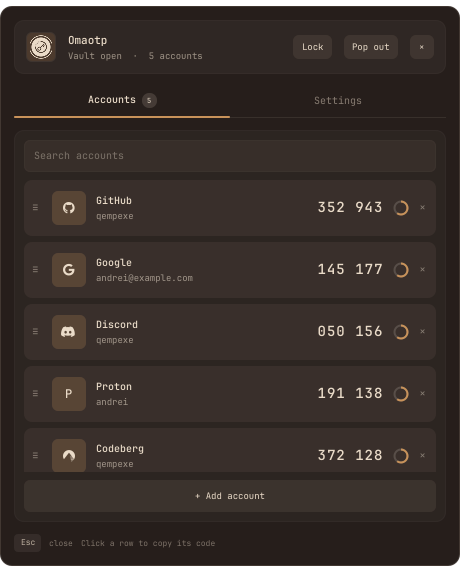
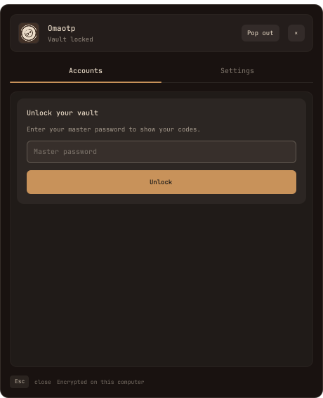
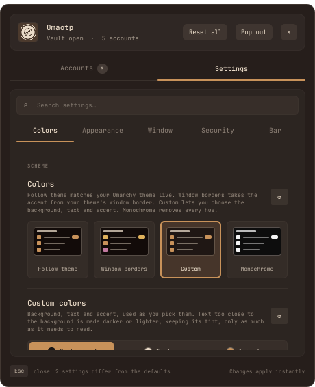
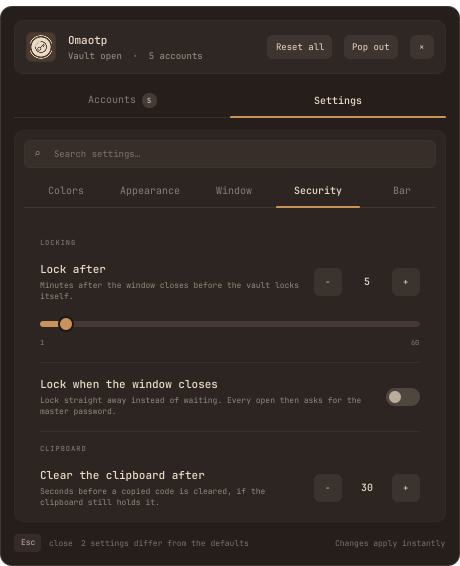
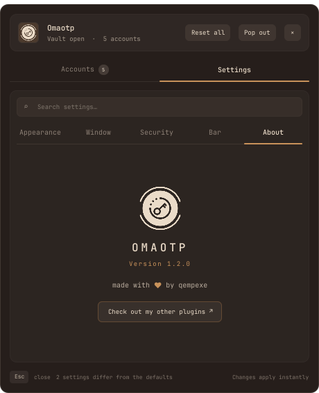

<p align="center">
  <picture>
    <source media="(prefers-color-scheme: light)" srcset="assets/logo-dark.png">
    
  </picture>
</p>

<h1 align="center">Omaotp</h1>

<p align="center">One-time codes in your <a href="https://omarchy.org">Omarchy</a> bar, from an encrypted vault only you can open.</p>


An authenticator for two-factor sign-ins, like FreeOTP, Aegis or Google Authenticator,
living in the bar. The bar shows your first account's icon in its countdown ring. Click
it and your accounts open, each with its code; click a row and the code is copied, and
cleared from the clipboard again a little later. The secrets stay in a vault on this
computer, encrypted behind a master password.

## Features

- **Standard codes**: RFC 6238 TOTP, 6 or 8 digits, SHA1, SHA256 or SHA512, any period
  from 15 to 120 seconds, the same codes your phone app makes.
- **An encrypted vault**: AES-256 with a key from your master password, plus an HMAC so
  a changed vault is refused before it is opened.
- **One click to copy**: the clipboard clears itself after 30 seconds, if it still holds
  the code.
- **Locks itself**: a few minutes after the window closes, or straight away.
- **Search and order**: filter by issuer or account, and drag your accounts into the
  order you want. The top one is the one on the bar.
- **Your theme**: follows your Omarchy theme live, takes your window border's colors, or
  uses your own colors, or none at all.
- **Docked or popped out**: a panel on the bar, or a window you can move, resize and tile.

### Accounts



Each row has the service's icon (GitHub, Google, Discord and many more, or a letter), the
issuer and account, the code and a ring that runs out with it. It turns yellow at 10
seconds and red at 5. Click a row to copy its code; the code lights up in the accent.

**+ Add account** takes an `otpauth://totp/…` link (from the site's setup page, or a QR
code decoder), or the issuer, the account and the secret by hand. The `×` on a row asks
once more before it removes the account.

<br clear="right">

### The vault



The first time, Omaotp asks for a master password of at least 8 characters, twice, and
creates the vault. After that it asks for it to unlock. **Lock** in the header, or a
middle click on the bar button, locks it again at once.

<br clear="right">

## Installation

```bash
omarchy plugin add https://github.com/qempexe/omarchy-omaotp.git --enable --yes
omarchy restart shell
```

Then add **Omaotp** to your bar, from the bar settings or with
`{ "id": "io.github.qempexe.omaotp" }` under `bar` → `layout` in
`~/.config/omarchy/shell.json`.

It needs `python3` and `openssl` for the vault, and `wl-clipboard` (`wl-copy`,
`wl-paste`) for copying. Omarchy has them all.

## Usage

### Bar button

| Click | Does |
| --- | --- |
| Left | opens Omaotp on the Accounts tab, or closes it |
| Middle | locks the vault (or copies the first code, or nothing: see **Middle click**) |
| Right | the Settings tab |

**Esc** or **×** closes it, and **Alt+←/→** switches tabs.

### Pop out and dock

The header's **Pop out** turns Omaotp into a real window you can move, resize and tile,
and **Dock** puts it back on the bar. **Settings › Window › Open as** picks which one the
bar button opens.

Hyprland tiles new windows. To float and center the popped-out window, add to
`~/.config/hypr/hyprland.lua`:

```lua
o.window({ class = "^org\\.quickshell$", title = "^Omaotp$" }, { tag = "+omaotp-window" })
o.window({ tag = "omaotp-window" }, { float = true })
o.window({ tag = "omaotp-window" }, { center = true })
o.window({ tag = "omaotp-window" }, { size = { 460, 560 } })
```

## Configuration

The **Settings** tab, or a right click on the bar button. Everything applies at once and
is saved in `~/.config/omaotp/settings.json`.

<table>
<tr>
<td></td>
<td></td>
<td></td>
</tr>
</table>

The settings sit in tabs, with a search box above them that looks through every tab.
Each row has a **↺** to put it back, and **Reset all** in the header puts back everything.

| Tab | Setting | Default | |
| --- | --- | --- | --- |
| Colors | Colors | Follow theme | Follow theme, Window borders, Custom or Monochrome |
| | Custom colors | | background, text and accent; text too close to the background is darkened or lightened just enough to read |
| | Text | Always readable | or Theme, or My text color |
| Appearance | Card style | Soft | Soft, Outline or Flat |
| | Spacing | Comfortable | Compact, Comfortable or Spacious |
| | Roundness | 4 | 0 (square) to 20 |
| | Text size | 1 | 0.8 to 1.5 |
| | Issuer icons | on | or the first letter |
| | Split codes in two | on | `123 456`; the copied code has no space |
| Window | Window width, height | 460 × 560 | 380 to 1000, 400 to 1100 |
| | Open as | Bar panel | or Own window |
| | Window outline | off | the edge in your window border's colors, as a gradient or one color |
| | Window tint | 0 | 0 to 30, the accent washed over the background |
| | Window opacity | 97 | 50 to 100 |
| Security | Lock after | 5 minutes | 1 to 60, after the window closes |
| | Lock when the window closes | off | |
| | Clear the clipboard after | 30 s | 10 to 120 |
| | Hide codes until hovered | off | dots until the mouse is over the row |
| Bar | Bar button shows | Icon and ring | or Ring and code, or Only the lock |
| | Middle click | Lock the vault | or Copy the first code, or Nothing |

**Window borders** and the outline read the active border from your theme's
`hyprland.lua` (or `hyprland.conf`), and only take `#rrggbb` colors and an angle from it.
Settings saved by 1.1 keep working under their new names.

**About**, the last tab, has the logo, the version and a link to more plugins.

## Troubleshooting

- **Wrong master password.** There is no way around it: without the password the vault
  can't be opened, by design. Keep it somewhere safe, and back up `vault.enc`.
- **A code is refused.** Check the computer's clock (`timedatectl`): TOTP codes depend on
  the time. Codes are made for the current 30-second window.
- **That is not a valid link.** Only `otpauth://totp/…` links are taken, with a base32
  secret, 6 or 8 digits and a period from 15 to 120 seconds. HOTP (counter) links aren't
  supported.
- **Where things live.**

  | Path | Contents |
  | --- | --- |
  | `~/.local/share/omaotp/vault.enc` | the vault, in a folder only you can open (0700) |
  | `~/.config/omaotp/settings.json` | your settings, nothing secret |

- **How the vault is kept.** AES-256-CBC by `openssl`, with PBKDF2-SHA256 and 300,000
  rounds from your master password, and an HMAC-SHA256 of the encrypted bytes with its
  own key from the password, checked before anything is decrypted. A vault without the
  HMAC is only taken when it really is a 1.1 vault, which is then sealed in the new form;
  a newer one with its HMAC removed is refused and left as it is. The file is written to
  a new file first and then moved over the old one, so a crash can't leave half a vault.
- **The master password** is never put on a command line. It goes to the helper on
  stdin and from there to `openssl` through a pipe, so it doesn't show in `ps`. It is
  kept in memory only while the vault is open; locking forgets it, the codes and anything
  typed into the window.
- **Copying** writes the code to `wl-copy` through its stdin, never as an argument. The
  clipboard is cleared after the time you set, only if it still holds that code.
- **Network.** None. Everything happens on this computer.
- **Text fields.** They never read the clipboard by themselves. **Ctrl+V** (or
  **Shift+Insert**) pastes once through `wl-paste`, the first line only, at most 1 KB.
- **No import yet** from Aegis or FreeOTP exports, and no QR scanning from the screen:
  add accounts by link or by hand.

## Contributing

Bug reports and ideas are welcome as [issues](https://github.com/qempexe/omarchy-omaotp/issues).
[CONTRIBUTING.md](CONTRIBUTING.md) explains how to add a setting or an icon, the rules
and the tests. Everyone taking part is expected to follow the
[code of conduct](CODE_OF_CONDUCT.md). What changed in each version is in the
[changelog](CHANGELOG.md).

### Source layout

```
qml/
├── BarWidget.qml     the bar button and its ring, the vault's state, the helper's job
│                     queue, copying, docking and popping out, the theme's border
├── core/             UiState (colors, spacing, the open tab), SettingsStore (saved
│                     locally, applied at once)
├── panel/            Panel (docked), PopoutWindow, OtpView (the window), AccountsPage,
│                     SettingsView + SettingRow + TileArt, AboutPage
├── controls/         Btn, Chip, Sw, Txt, InputBox, PasteInput (a text field with a
│                     bounded paste, and dots for passwords)
└── js/               Schema.js (every setting), Otp.js (checking what the helper prints,
                      icons), Theme.js (border colors)
bin/omaotp.py         the vault and the codes: status, init, codes, add, remove, reorder
assets/               the logo, light and dark
tools/gen-manifest.js node tools/gen-manifest.js
tests/test_model.js   node tests/test_model.js
```

### Upgrading and uninstalling

```bash
omarchy plugin update io.github.qempexe.omaotp
omarchy restart shell
```

```bash
omarchy plugin remove io.github.qempexe.omaotp
omarchy restart shell
rm -rf ~/.config/omaotp                       # settings
# ~/.local/share/omaotp holds your vault: keep it, or delete it only when you're sure
```

## License and credits

[MIT](LICENSE).

- Codes follow [RFC 6238](https://datatracker.ietf.org/doc/html/rfc6238) (TOTP) and the
  `otpauth://` link format used by authenticator apps.
- Encryption by [OpenSSL](https://www.openssl.org), icons from [Nerd Fonts](https://www.nerdfonts.com).
- Thanks to the **Omarchy** project for the shell and its plugin system, and to **Quickshell** and **Qt** for the toolkit.
- Thanks to everyone who tests it and reports issues.

Omaotp is an independent community plugin. It is not affiliated with or endorsed by
Omarchy or any of the services whose icons it shows; their names and logos belong to
their owners.
