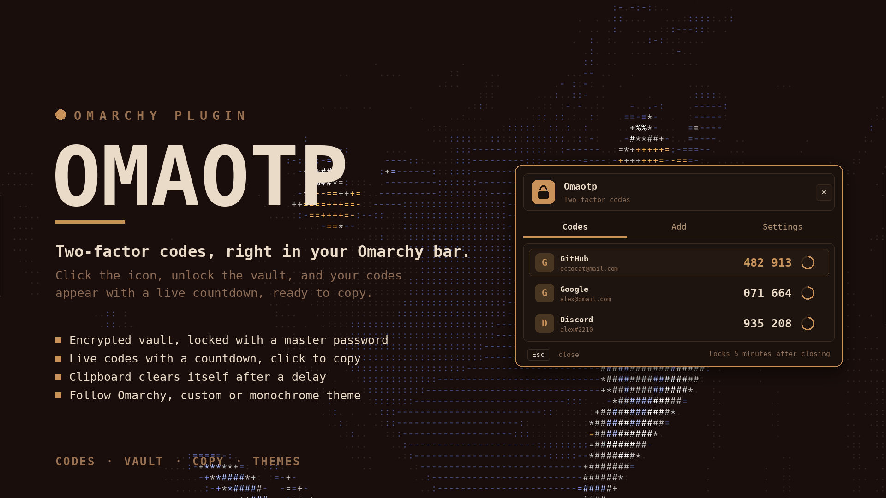

# omaotp

A FreeOTP-style authenticator for the Omarchy bar. The bar shows one icon, ringed by its countdown, for the first account in your list. You set that order by dragging. Click the bar to open the list, search it, copy any code with one click, and drag accounts into the order you want.

Codes are RFC 6238 TOTP, the same codes FreeOTP, Aegis and Google Authenticator produce. Secrets are stored in an encrypted vault on this machine, protected by a master password.



## Install

```sh
omarchy plugin add https://github.com/qempexe/omarchy-omaotp.git --enable --yes
```

On first open, create a vault with a master password of at least 8 characters. The vault is created automatically; there is no separate setup step.

## Requirements

| Tool | Used for | Usually installed |
| --- | --- | --- |
| `python3` | the helper that generates codes | yes |
| `openssl` | encrypting the vault | yes |
| `wl-clipboard` (`wl-copy`, `wl-paste`) | copying codes | yes on Omarchy |

## Using it

* **Add an account:** open the panel, click *Add account*, then either paste an `otpauth://totp/...` link (from a QR code decoder or the site's setup page) or fill in issuer, account and secret.
* **Copy a code:** click its row. The clipboard is cleared after the time set in *Clear clipboard after* (default 30 seconds) if it still holds that code.
* **Search:** type in the search box to filter by issuer or account.
* **Reorder:** press and drag the `≡` handle on the left of a row, then release it over the row you want. The new order is saved in the vault, and the account at the top of the list is the one shown in the bar.
* **Remove an account:** click the `×` on its row, then click *Remove?* to confirm.
* **Lock:** click *Lock* in the header or middle-click the widget. The vault also locks after the time set in *Lock after* (default 5 minutes) once the panel closes.

Codes refresh every 30 seconds, when the time window changes.

## Settings

Open the panel's *Settings* tab. Changes apply at once and are saved to `~/.config/omaotp/settings.json`. The file is watched, so a hand edit applies live too.

| Setting | Default | Choices |
| --- | --- | --- |
| Accent color | Theme | Theme, Custom, Mono |
| Custom color | `#39d353` | any `#rrggbb` (swatches, or type and press Enter) |
| Lock after | 5 minutes | 1, 2, 5, 10, 15, 30 |
| Clear clipboard after | 30 s | 10, 20, 30, 60, 120 |

## Color

Pick the accent color in *Settings*, or from the *Accent color* row:

| Mode | What it uses |
| --- | --- |
| **Theme** (default) | The background, text and accent colors of your current Omarchy theme, read from `~/.config/omarchy/current/theme/colors.toml`. The panel changes as soon as you switch themes. |
| **Custom** | Any `#rrggbb` color. Pick a swatch, type a hex value and press Enter, or click Reset. |
| **Mono** | Shades of your bar text color. Good for a fully neutral bar. |

Countdown warnings are always shown in yellow (10 seconds left) and red (5 seconds left), in every mode.

Theme mode reads `background`, `foreground` and `accent` from `~/.config/omarchy/current/theme/colors.toml` and watches that file. If the file or any of those three keys is missing, the panel falls back to the bar's own colours and the accent to the default green.

## Where data lives

| Path | Contents |
| --- | --- |
| `~/.local/share/omaotp/vault.enc` | encrypted vault (AES-256-CBC, PBKDF2-SHA256, 300,000 iterations) |
| `~/.config/omaotp/settings.json` | your settings |
| `~/.config/omaotp/color` | old colour file from 1.0.x, read once for migration, then left in place |

Nothing secret is written to the shell settings file or to the log.

## Security notes

* The master password is never passed on the command line. It goes to the helper on stdin and from there to openssl through a pipe, so it does not show up in `ps`.
* The password and decrypted codes are held in memory only while the vault is open. Locking clears them.
* The QML makes no network requests. Everything runs locally.
* Back up `vault.enc` and remember the master password. Without the password the vault cannot be recovered.

## Limitations

* No import yet from Aegis or FreeOTP exports. Add accounts by link or by hand for now.
* No QR scanning from the screen yet.
* Only 30-second periods are shown as expected. Other periods work but refresh at the shortest period across your accounts.
* Month and weekday labels are English.

## Development

```
manifest.json          plugin manifest (id, settings schema)
BarWidget.qml          bar item: vault state, helper job queue, countdown ring
Panel.qml              popup: setup, unlock, accounts, add, settings
Otp.js                 shared model: errors, issuer icons, colors, parsing
bin/omaotp.py          helper: encrypted vault, TOTP, otpauth parsing
Settings.js            the list the Settings tab is built from
SettingsStore.qml      settings in memory, saved to settings.json and watched
Foreground.qml         hidden probe for the bar colours
FieldBox.qml, FlatButton.qml, SectionLabel.qml   small UI pieces
tests/                 unit tests for Otp.js and Settings.js (node tests/otp.test.js)
assets/key.png         icon shown in the bar for accounts with no known brand icon
```

The helper's commands are `status`, `init`, `codes`, `add` and `remove`. Each prints one line of JSON. Test it on its own with:

```sh
printf 'my master password\n' | python3 bin/omaotp.py codes
```

## License

MIT
